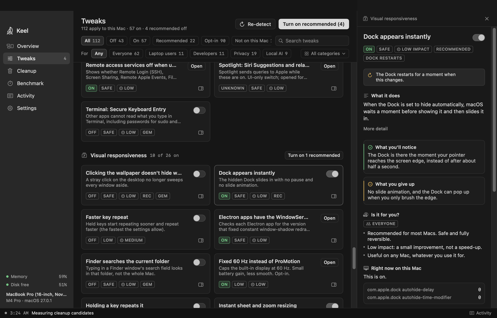
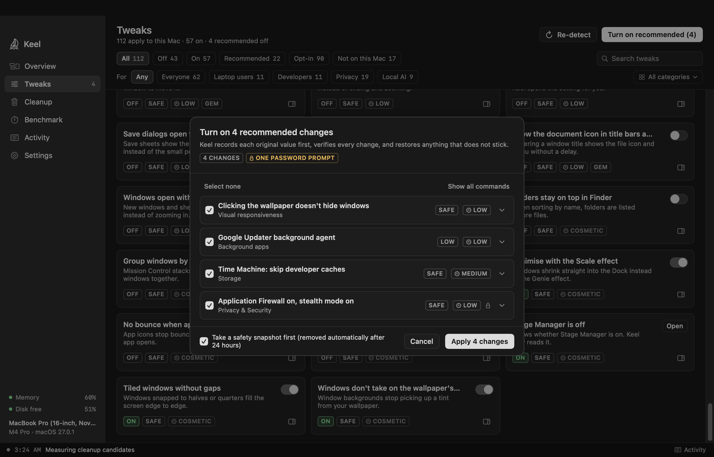
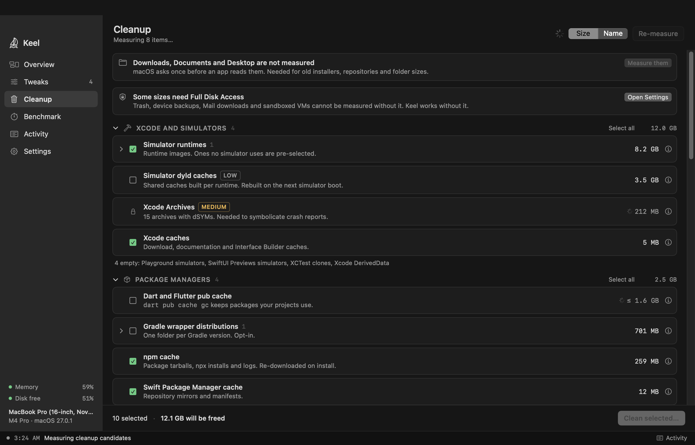
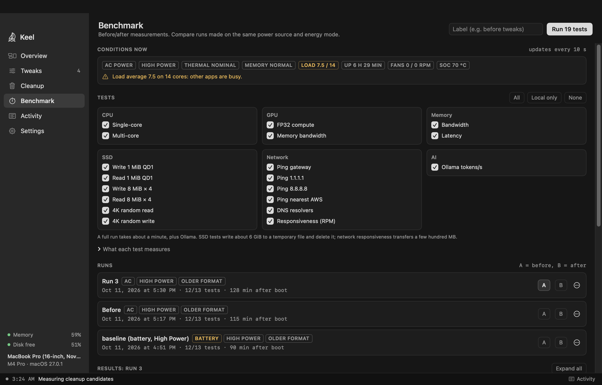
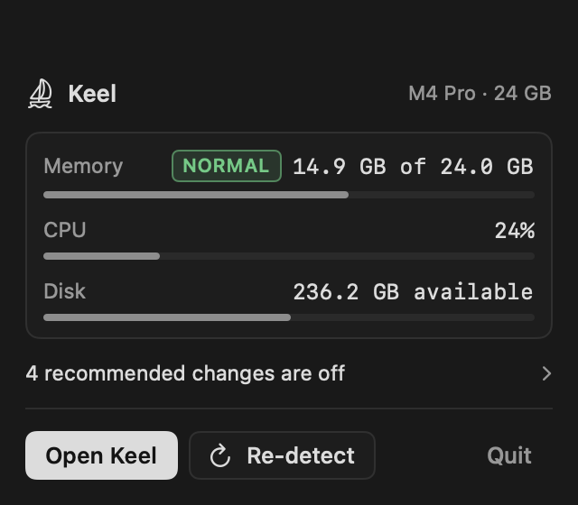

<div align="center">


# Keel

**Tune and clean your Apple Silicon Mac, and undo any change exactly.**

[](https://github.com/mohdmahmodi/keel/releases/latest)
[](https://github.com/mohdmahmodi/keel/actions/workflows/build.yml)
[](LICENSE)
<br>
[](#requirements)
[](#requirements)
[](Package.swift)
[](docs/RELEASING.md#verify-a-download)

[**Download**](https://github.com/mohdmahmodi/keel/releases/latest) ·
[Website](https://keel.mohdmahmodi.com) ·
[What's not included](docs/NOT-INCLUDED.md) ·
[Privacy](docs/PRIVACY.md) ·
[Build from source](#build-from-source)

<br>

<picture>
  <source media="(prefers-color-scheme: light)" srcset="docs/screenshots/tweaks-drawer-1280-light.png">
  
</picture>

</div>

## About

Keel is a native macOS app, written in Swift and SwiftUI. For each setting it shows the current value on your Mac
and what changing it does. It also says what you give up. When you turn a change on, Keel saves the original value,
applies the change and checks that it took effect. Turning the change off writes the saved value back.

It has 159 tweaks, a cleanup tool that measures real folder sizes, and a benchmark for before and after comparisons.
There is no account, no analytics and no background service unless you turn one on.

## Features

### Tweaks

159 settings in 12 categories. Every card shows its live state, its risk, an impact rating and who it's for. The
detail panel shows the exact keys or commands, what you'll notice, what you give up, and the sources.

| Category | Count | Examples |
|---|---:|---|
| Performance | 9 | High Power Mode on the power adapter, thermal throttling check, Rosetta status |
| Memory | 5 | Browser Memory Saver, shut down background iOS simulators |
| Storage | 8 | Release space held by local snapshots, Time Machine skips developer caches |
| Background apps | 8 | Launch items whose app is gone, don't reopen apps after a restart |
| Network | 9 | Cloudflare DNS with your current resolver as fallback, AirDrop receiving set to No One |
| Developer | 16 | SSH connection reuse, Git file monitor, Docker resource limits, finding `node_modules` folders Spotlight indexes |
| AI tools | 12 | GPU memory limit for local models, Ollama flash attention and 8-bit KV cache |
| Battery & Power | 19 | Low Power Mode on battery only, battery charge limit, Power Nap off on battery |
| Privacy & Security | 23 | Firewall with stealth mode, personalized ads off, password right after sleep |
| Visual responsiveness | 19 | Dock appears instantly, window open animation off, reduce motion |
| Finder & desktop | 17 | Show all filename extensions, folders on top, screenshots go to their own folder |
| Keyboard, trackpad & sound | 14 | Faster key repeat, three-finger drag, startup sound off |

Tweaks adapt to the Mac they run on. Battery settings apply only to laptops, and the GPU memory limit is sized
from your installed memory. Developer and AI tweaks need the tool they change, such as Xcode, Docker or Ollama. A
tweak that doesn't apply to your Mac is listed under **Not on this Mac**, with the reason. A small set is marked **recommended**, and everything else is opt-in.

<table>
  <tr>
    <td width="50%" valign="top">
      <picture>
        <source media="(prefers-color-scheme: light)" srcset="docs/screenshots/confirm-light.png">
        
      </picture>
      <p><b>Confirm before applying.</b> Each batch lists what will change. It shows the commands and whether
      macOS will ask for a password. Changes that need a password ask once for the whole batch.</p>
    </td>
    <td width="50%" valign="top">
      <picture>
        <source media="(prefers-color-scheme: light)" srcset="docs/screenshots/cleanup-1280-light.png">
        
      </picture>
      <p><b>Cleanup.</b> Measures caches and leftovers such as Xcode data, simulator runtimes, package manager
      caches and the Trash. It deletes only what you select. Virtual machines, models, repositories, browser
      profiles and Downloads are never deleted.</p>
    </td>
  </tr>
  <tr>
    <td width="50%" valign="top">
      <picture>
        <source media="(prefers-color-scheme: light)" srcset="docs/screenshots/benchmark-1280-light.png">
        
      </picture>
      <p><b>Benchmark.</b> Tests CPU, GPU, memory bandwidth and latency, SSD, network, DNS and Ollama. Keel
      records the power source and energy mode with each run. It compares two runs against a noise band, so
      you can see whether a change made a real difference.</p>
    </td>
    <td width="50%" valign="top">
      <p align="center">
        <picture>
          <source media="(prefers-color-scheme: light)" srcset="docs/screenshots/menubar-light.png">
          
        </picture>
      </p>
      <p><b>Menu bar.</b> Shows memory pressure, CPU and free disk space. It also shows how many recommended
      changes are off. The <b>Activity</b> page keeps a plain-language log of everything Keel did.</p>
    </td>
  </tr>
</table>

### What Keel won't do

- It never asks you to turn off System Integrity Protection, Gatekeeper or FileVault.
- It doesn't "free RAM" or purge memory. It also leaves out the network and kernel tweaks that don't help on Apple
  silicon. [docs/NOT-INCLUDED.md](docs/NOT-INCLUDED.md) lists each one with the reason.
- It doesn't run at login or in the background unless you turn that on.
- It doesn't update itself. It tells you when a new version exists, and you download it.

## Requirements

- A Mac with Apple silicon (M1 or later). Intel Macs are not supported.
- macOS 15 Sequoia or later.

## Install

1. Download `Keel-x.y.z.dmg` from the [latest release](https://github.com/mohdmahmodi/keel/releases/latest).
2. Open the disk image and drag **Keel** to **Applications**.
3. Open Keel from Applications or Spotlight.

The app is signed with a Developer ID and notarized by Apple, so it opens without warnings. To check a download
yourself, see [Verify a download](docs/RELEASING.md#verify-a-download).

## Using Keel

On launch, Keel reads the current state of every tweak. Nothing changes until you switch something on and confirm.

Closing the window leaves Keel in the menu bar. Quit from the menu bar icon, or turn off *Keep running in the menu
bar* in Settings.

### Permissions

Every permission is optional. macOS asks for each one only when you use the feature that needs it.

| Prompt | When | Why |
|---|---|---|
| Administrator password | Applying or reverting a tweak that needs root, such as energy settings, the firewall or DNS | macOS asks once per batch. With the helper installed, it doesn't ask at all. |
| "Keel wants to control Finder" | Measuring or emptying the Trash | The Trash is protected, so Keel asks Finder to do it, like the Finder menu command does. |
| "Find devices on your local network" | Running the network benchmark | Keel pings your router and times your DNS server. |
| Full Disk Access | Set by you in System Settings | Lets Cleanup also measure the Trash, Mail downloads and iOS device backups. |

### The optional helper

The helper removes the password prompt for privileged changes.

1. In Keel, open **Settings** and click **Install** next to *Keel helper*.
2. macOS opens **System Settings › General › Login Items & Extensions**. Turn **Keel** on under
   *Allow in the Background*.
3. The helper shows **Enabled** in Keel's Settings.

The helper is a small root daemon inside Keel.app. It accepts requests only from a copy of Keel signed by the same
developer. It runs only the operations on a fixed allow-list, such as specific `pmset` keys, two `sysctl`s, DNS
servers, the firewall and Time Machine exclusions. It never runs arbitrary commands. The full list is the `PrivOp`
enum in [PrivOp.swift](Sources/KeelShared/PrivOp.swift). To remove it, click **Remove** in Settings.

### Undo

- **One tweak.** Switch it off. Keel restores the value it saved before the change, then checks it.
- **Everything.** On the Tweaks page, filter by **On** and switch each one off. Do this before uninstalling.
- **Cleanup** can't be undone. Apps rebuild their caches, and an emptied Trash is gone. Each item says what it
  costs to rebuild.

Saved originals live in `~/Library/Application Support/Keel/backups/`. Keep that folder until every tweak is off.

<details>
<summary><b>Uninstall completely</b></summary>

1. Turn off every tweak in Keel. Some tweaks move launchd property lists into Keel's backups folder, and turning
   them off moves them back.
2. In Keel's Settings, click **Remove** next to *Keel helper* and turn off **Start at login**.
3. Quit Keel from the menu bar, then move `/Applications/Keel.app` to the Trash.
4. Remove Keel's data and preferences:

   ```bash
   rm -rf ~/Library/Application\ Support/Keel
   defaults delete com.mohdmahmodi.keel 2>/dev/null
   rm -rf ~/Library/Caches/com.mohdmahmodi.keel ~/Library/HTTPStorages/com.mohdmahmodi.keel \
          ~/Library/Saved\ Application\ State/com.mohdmahmodi.keel.savedState
   ```

5. If you skipped step 2, remove the login agent and the helper by hand:

   ```bash
   launchctl bootout gui/$(id -u)/com.keel.app 2>/dev/null
   rm -f ~/Library/LaunchAgents/com.keel.app.plist
   sudo launchctl bootout system/com.mohdmahmodi.keel.helper 2>/dev/null
   ```

6. Tweaks that keep a `sysctl` across restarts install a boot daemon named `com.keel.sysctl.<name>`. Turning the
   tweak off removes it. To remove any that are left:

   ```bash
   find /Library/LaunchDaemons -name 'com.keel.sysctl.*.plist' | while read -r p; do
     sudo launchctl bootout system/"$(basename "$p" .plist)" 2>/dev/null
     sudo rm "$p"
   done
   ```

7. If you granted Full Disk Access or Automation, remove Keel from those lists in
   **System Settings › Privacy & Security**.

</details>

### Updates

Keel checks GitHub once a day for a new release. You can turn this off in Settings. When there is one, Settings
shows the version and release notes, with a **Download** button. To update, quit Keel and replace the app in
Applications. Your settings and saved originals are kept.

## Build from source

You need an Apple Silicon Mac with macOS 15 or later and Xcode 16 or later. The Command Line Tools with Swift 6 also
work. There are no third-party dependencies.

```bash
git clone https://github.com/mohdmahmodi/keel.git
cd keel
```

### Run it

The quickest way to try a change is to build and run the debug binary:

```bash
swift run Keel
```

You can also open the package in Xcode, pick the **Keel** scheme and press Run:

```bash
xed .
```

The debug binary runs outside an app bundle. Features that depend on the bundle, like the helper and start at
login, only work in the packaged app below.

### Build the app bundle

```bash
scripts/build-app.sh release
open dist.noindex/Keel.app
```

This builds `dist.noindex/Keel.app` for arm64 with an ad-hoc signature. To build it and copy it to
`/Applications` in one step, run `scripts/install.sh`. Check the bundle layout, plists and signatures with
`scripts/verify-bundle.sh`.

An ad-hoc build runs on the Mac that built it. The helper needs a Developer ID signature, so ad-hoc builds use the
administrator prompt for privileged changes. To sign with your own Developer ID, run:

```bash
KEEL_SIGN_IDENTITY=auto scripts/build-app.sh release
```

Notarized releases are made with `scripts/release.sh`. The steps are in [docs/RELEASING.md](docs/RELEASING.md).

### Test

```bash
scripts/test.sh
```

This runs the privileged-operation allow-list, the engine tests, the catalog lint, the hardware simulation and the
cleanup delete paths in a sandboxed fake home folder. It doesn't change anything on your Mac. CI runs the allow-list,
engine, lint and simulation checks on every push and pull request.

```bash
scripts/test.sh --live
```

The live run also applies and restores every user-level tweak on this Mac. It checks that each original comes back
byte for byte. The Dock and Finder restart during the run, and nothing is left changed.

<details>
<summary><b>Command-line modes</b></summary>

The app binary has headless modes that print what Keel sees without opening a window.

| Command | Prints |
|---|---|
| `.build/debug/Keel --machine` | The hardware profile: model, chip, memory, power capabilities, network service |
| `.build/debug/Keel --detect` | The current state of every tweak on this Mac |
| `.build/debug/Keel --simulate` | Detection under simulated Macs, such as a desktop, 8 GB, macOS 15 or no Xcode |
| `.build/debug/Keel --cleanup-scan` | Measured cleanup sizes |
| `.build/debug/Keel --benchmark "label"` | Runs the benchmark and saves it under that label |
| `.build/debug/Keel --lint` | Catalog checks for every tweak's metadata |
| `.build/debug/Keel --helper-test` | Registers the helper, waits for approval and makes one call (Developer ID builds only) |

</details>

<details>
<summary><b>Where Keel stores things</b></summary>

| What | Path |
|---|---|
| Saved originals | `~/Library/Application Support/Keel/backups/` |
| Activity log | `~/Library/Application Support/Keel/activity.jsonl` |
| Benchmark runs | `~/Library/Application Support/Keel/benchmarks/*.json` |
| Preferences | `~/Library/Preferences/com.mohdmahmodi.keel.plist` |
| Start-at-login agent | `~/Library/LaunchAgents/com.keel.app.plist` |
| Helper daemon | `Keel.app/Contents/Library/LaunchDaemons/com.mohdmahmodi.keel.helper.plist` |
| Persistent sysctl daemons | `/Library/LaunchDaemons/com.keel.sysctl.*.plist` |

</details>

### Project layout

```
Sources/KeelShared   Allow-listed privileged operations and their executor, shared with the helper
Sources/KeelHelper   Root helper: an SMAppService daemon, or a one-shot run through the admin prompt
Sources/Keel/App     Entry point, menu bar extra, command-line modes
Sources/Keel/Core    Engine, hardware profile, backups, activity log, updates, tweaks, cleanup, benchmark
Sources/Keel/UI      Theme, components and pages
scripts/             Build, install, test and release scripts
docs/                Architecture, style, privacy, releasing and the website
```

Read [docs/ARCHITECTURE.md](docs/ARCHITECTURE.md) before changing the engine. To add a tweak, follow
[docs/STYLE.md](docs/STYLE.md) for wording and [CONTRIBUTING.md](CONTRIBUTING.md) for the checks a pull request
needs.

## Contributing

Bug reports, tweak suggestions and pull requests are welcome. A good tweak suggestion names the exact setting and
the macOS version you checked it on. It should also link to a source that shows what it does. See
[CONTRIBUTING.md](CONTRIBUTING.md).

Please report security issues privately, as described in [SECURITY.md](SECURITY.md).

## License

MIT. See [LICENSE](LICENSE).
